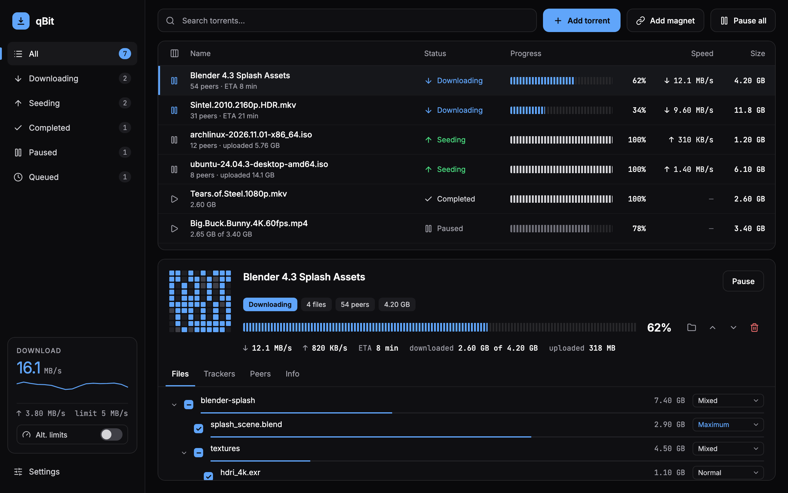
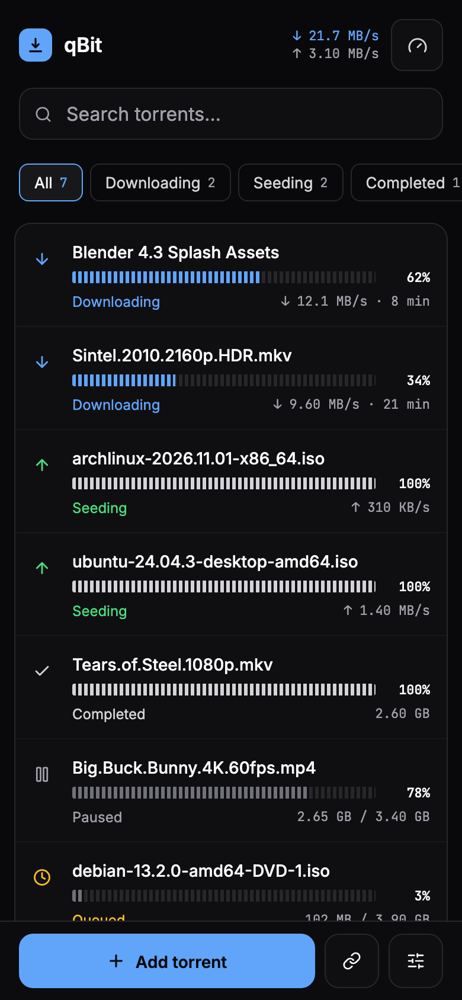
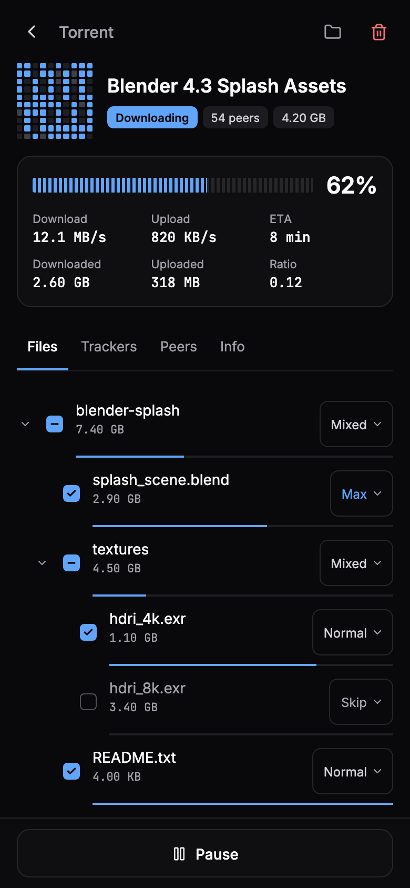
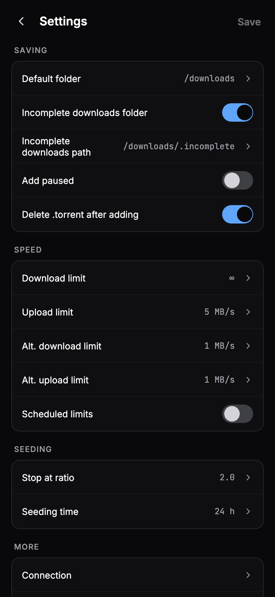

<p align="center">
  
</p>

<h1 align="center">qBit</h1>

<p align="center">
  A fast, modern alternative WebUI for qBittorrent, on desktop and on your phone.
</p>

<p align="center">
  <a href="https://github.com/Ivan-Kuzmichev/qbit/releases/latest"></a>
  <a href="https://github.com/Ivan-Kuzmichev/qbit/actions/workflows/ci.yml"></a>
  
  <a href="LICENSE"></a>
</p>

<p align="center">
  <b>English</b> · <a href="README.ru.md">Русский</a>
</p>

<p align="center">
  <a href="https://ivan-kuzmichev.github.io/qbit/"><b>Try the live demo</b></a>
</p>

<picture>
  <source media="(prefers-color-scheme: light)" srcset="docs/screenshots/desktop-light.png">
  
</picture>

## Features

- **Everyday work in one place:** search, status filters, categories and tags, multi-select, a context menu and keyboard shortcuts.
- **Torrent details:** piece map, a file tree with priorities, trackers, peers with country flags.
- **Adding torrents:** drag and drop `.torrent` files or paste magnet links, and pick files before the download starts.
- **Speed limits:** per torrent, global and alternative, with a live speed chart in the sidebar.
- **Settings:** the qBittorrent options you actually use. Only what you changed gets saved.
- **Telegram notifications:** a message from your bot when a torrent completes.
- **A real mobile version:** its own screens, large tap targets and a home screen install (PWA).
- **Light and dark themes,** or follow your system. Four accent colors.
- **English and Russian.**
- **Handles 1000+ torrents:** the list is virtualized and updates only what changed.
- **Private:** no backend, no analytics, no external requests. Fonts, icons and flags are bundled.

## On your phone

<p align="center">
  
  
  
</p>

## Install

qBit needs **qBittorrent 5.0 or newer** (WebAPI 2.11+). On older versions it shows a message asking you to upgrade.

qBittorrent serves qBit itself, so there is nothing else to run. Pick one of these three ways, then in qBittorrent go to **Options → Web UI**, turn on **Use alternative WebUI** and set the path to the `qbit` folder (the one that contains `public`).

### 1. Docker mod

For `lscr.io/linuxserver/qbittorrent`. Add the variable and recreate the container:

```yaml
environment:
  - DOCKER_MODS=ghcr.io/ivan-kuzmichev/qbit-mod:latest
```

The path is `/qbit`. To pin a version, use a tag instead of `latest`, for example `qbit-mod:0.1.2`.

### 2. Release archive

For any image. Download `qbit.zip` from the [latest release](https://github.com/Ivan-Kuzmichev/qbit/releases/latest), unpack it on the host and mount it:

```yaml
volumes:
  - ./qbit:/qbit:ro
```

The path is `/qbit`.

### 3. Git

```sh
git clone --single-branch -b latest-release https://github.com/Ivan-Kuzmichev/qbit ./qbit
```

Mount it and set the path as in the second option.

### Using `qBittorrent.conf`

Instead of the checkbox:

```ini
WebUI\AlternativeUIEnabled=true
WebUI\RootFolder=/qbit
```

Restart the container afterwards.

## Update

qBit makes no external requests, so it doesn't check for updates or update itself.

| Installed with | How to update |
| --- | --- |
| Docker mod, `latest` | `docker compose up -d --force-recreate` |
| Docker mod, pinned tag | change the tag, then recreate the container |
| Release archive | replace the contents of the `qbit` folder and reload the page |
| Git | `git -C ./qbit pull` and reload the page |

Recreating the container restarts qBittorrent, which pauses transfers for that moment.

## Go back to the standard interface

Turn off **Settings → WebUI → Use alternative WebUI** in qBit, or the same option in qBittorrent. With the Docker mod, also remove `DOCKER_MODS` and recreate the container.

If the WebUI is broken and you can't reach the settings, set `WebUI\AlternativeUIEnabled=false` in `qBittorrent.conf` and restart the container.

To return to an earlier version, use the tag of that release (`qbit-mod:X.Y.Z`) or its `qbit.zip`.

## Telegram notifications

1. Create a bot with [@BotFather](https://t.me/BotFather) and send it any message, otherwise it can't write to you.
2. In qBit, open **Settings → Notifications**, turn it on, then enter the bot token and your chat ID.

qBittorrent sends the message itself with `curl`, using its "run external program on torrent finished" option. `curl` is included in the linuxserver image; with another image, check that it's there. This replaces any command you already have in that option, and qBit warns you first.

The token is stored in the qBittorrent settings as plain text: anyone with WebUI access can see it, and it ends up in the qBittorrent log. Use a bot made just for this.

## Development

Requires Node.js 22.

```sh
npm ci
cp .env.example .env   # QBIT_URL=http://nas.local:8080
npm run dev
```

The dev server proxies `/api` to the qBittorrent at `QBIT_URL` and rewrites `Origin`, `Referer` and `Host`, so you don't have to turn off qBittorrent's CSRF protection or Host check.

`npm run build` puts the result in `qbit/public`. The version comes from `package.json` or the `APP_VERSION` variable.

```sh
npm test              # unit tests (Vitest)
npm run e2e           # e2e against a real qBittorrent in Docker; run npm run build first
npm run visual        # compares screens with the values from the mockups
npm run screenshots   # regenerates the pictures in docs/screenshots
npm run build:demo    # the live demo: the app with a simulated API, no server needed
npm run e2e:demo      # checks that build in a browser
```

Also: `npm run typecheck`, `npm run lint`, `npm run check:bundle`.

## Releases

A `v*` tag runs `.github/workflows/release.yml`: checks, build, `qbit.zip` and a GitHub Release with a changelog (git-cliff, Conventional Commits), the `latest-release` branch (a single commit, force-pushed) and the `ghcr.io/<owner>/qbit-mod` image tagged `latest` and `X.Y.Z`.

Tags with a hyphen (`v1.0.0-rc.1`) are pre-releases: they don't update `latest-release` or the Docker `latest` tag. After a repository's first release, make the GHCR package public once: Packages, Package settings, Change visibility, Public.

## License

[MIT](LICENSE)
