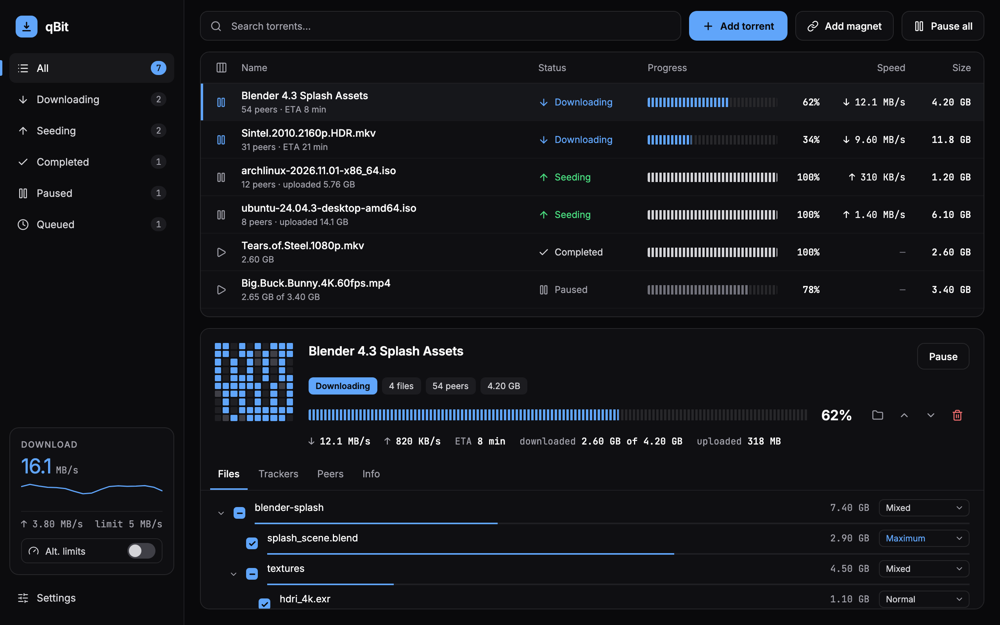
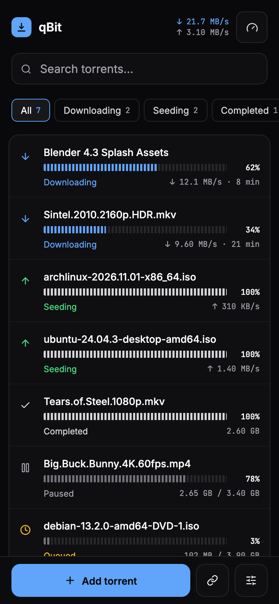
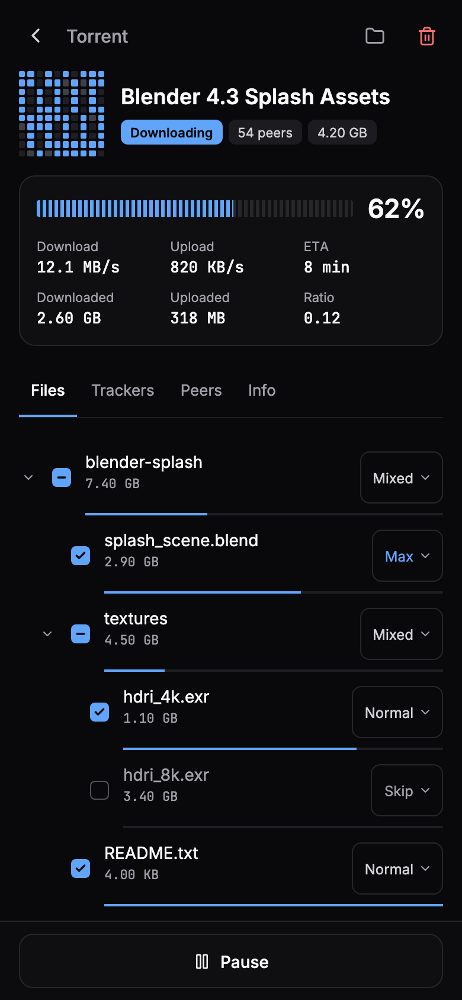
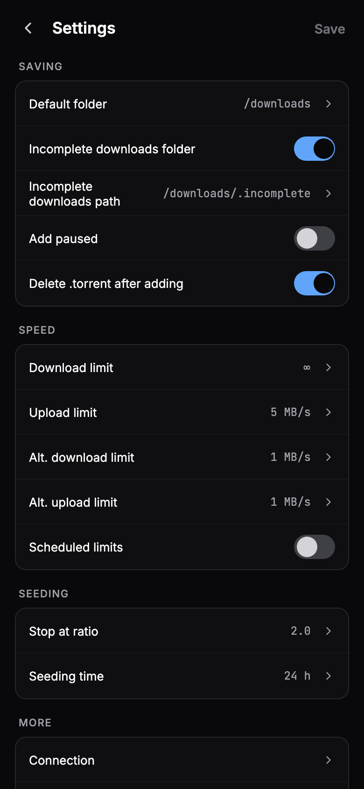

<p align="center">
  
</p>

<h1 align="center">qBit</h1>

<p align="center">
  Быстрый и современный альтернативный WebUI для qBittorrent: на компьютере и на телефоне.
</p>

<p align="center">
  <a href="https://github.com/Ivan-Kuzmichev/qbit/releases/latest"></a>
  <a href="https://github.com/Ivan-Kuzmichev/qbit/actions/workflows/ci.yml"></a>
  
  <a href="LICENSE"></a>
</p>

<p align="center">
  <a href="README.md">English</a> · <b>Русский</b>
</p>

<p align="center">
  <a href="https://ivan-kuzmichev.github.io/qbit/"><b>Открыть живое демо</b></a>
</p>

<picture>
  <source media="(prefers-color-scheme: light)" srcset="docs/screenshots/desktop-light.png">
  
</picture>

> На скриншотах английский интерфейс. Русский включается в **Settings → Appearance → Русский**.

## Возможности

- **Всё для повседневной работы:** поиск, фильтры по статусу, категории и теги, мультивыбор, контекстное меню и горячие клавиши.
- **Детали торрента:** карта кусков, дерево файлов с приоритетами, трекеры, пиры с флагами стран.
- **Добавление:** перетаскивание `.torrent` и magnet-ссылки, выбор файлов до начала загрузки.
- **Лимиты скорости:** для торрента, глобальные и альтернативные, живой график в боковой панели.
- **Настройки:** те опции qBittorrent, что нужны на практике. Сохраняется только изменённое.
- **Уведомления в Telegram:** сообщение от вашего бота, когда торрент скачан.
- **Настоящая мобильная версия:** свои экраны, крупные тап-зоны, установка на домашний экран (PWA).
- **Светлая и тёмная темы** или как в системе. Четыре акцентных цвета.
- **Английский и русский языки.**
- **Справляется с 1000+ торрентов:** список виртуализирован и обновляет только изменившееся.
- **Приватность:** без бэкенда, аналитики и внешних запросов. Шрифты, иконки и флаги лежат в бандле.

## На телефоне

<p align="center">
  
  
  
</p>

## Установка

Нужен **qBittorrent 5.0 или новее** (WebAPI 2.11+). На более старых версиях qBit покажет сообщение с просьбой обновиться.

qBit раздаёт сам qBittorrent, больше ничего запускать не нужно. Выберите один из трёх способов, затем в qBittorrent откройте **Настройки → Web UI**, включите **Использовать альтернативный WebUI** и укажите путь к папке `qbit` (той, в которой лежит `public`).

### 1. Docker mod

Для `lscr.io/linuxserver/qbittorrent`. Добавьте переменную и пересоздайте контейнер:

```yaml
environment:
  - DOCKER_MODS=ghcr.io/ivan-kuzmichev/qbit-mod:latest
```

Путь: `/qbit`. Чтобы закрепить версию, укажите тег вместо `latest`, например `qbit-mod:0.1.2`.

### 2. Архив из релиза

Для любого образа. Скачайте `qbit.zip` со [страницы релиза](https://github.com/Ivan-Kuzmichev/qbit/releases/latest), распакуйте на хосте и примонтируйте:

```yaml
volumes:
  - ./qbit:/qbit:ro
```

Путь: `/qbit`.

### 3. Git

```sh
git clone --single-branch -b latest-release https://github.com/Ivan-Kuzmichev/qbit ./qbit
```

Монтирование и путь такие же, как во втором способе.

### Через `qBittorrent.conf`

Вместо галки в настройках:

```ini
WebUI\AlternativeUIEnabled=true
WebUI\RootFolder=/qbit
```

После правки перезапустите контейнер.

## Обновление

qBit не делает внешних запросов, поэтому сам не проверяет обновления и не обновляется.

| Как установлен | Как обновить |
| --- | --- |
| Docker mod, `latest` | `docker compose up -d --force-recreate` |
| Docker mod, закреплённый тег | сменить тег и пересоздать контейнер |
| Архив из релиза | заменить содержимое папки `qbit` и обновить страницу |
| Git | `git -C ./qbit pull` и обновить страницу |

Пересоздание контейнера перезапускает qBittorrent, и на это время передача данных прерывается.

## Вернуться к стандартному интерфейсу

Выключите в qBit **Settings → WebUI → Use alternative WebUI** или ту же опцию в qBittorrent. Для Docker mod ещё уберите `DOCKER_MODS` и пересоздайте контейнер.

Если WebUI сломан и в настройки не попасть, задайте `WebUI\AlternativeUIEnabled=false` в `qBittorrent.conf` и перезапустите контейнер.

Чтобы вернуться на прежнюю версию, используйте тег этого релиза (`qbit-mod:X.Y.Z`) или его `qbit.zip`.

## Уведомления в Telegram

1. Создайте бота через [@BotFather](https://t.me/BotFather) и напишите ему любое сообщение, иначе он не сможет вам ответить.
2. В qBit откройте **Settings → Notifications**, включите уведомления и введите токен бота и ваш Chat ID.

Сообщение отправляет сам qBittorrent через `curl`, используя опцию «запуск внешней программы по завершении торрента». В образе linuxserver `curl` есть, в другом образе проверьте. Команда заменит то, что уже задано в этой опции, и qBit заранее об этом предупредит.

Токен хранится в настройках qBittorrent открытым текстом: его видят все, у кого есть доступ к WebUI, и он попадает в журнал qBittorrent. Заведите для этого отдельного бота.

## Разработка

Нужен Node.js 22.

```sh
npm ci
cp .env.example .env   # QBIT_URL=http://nas.local:8080
npm run dev
```

Dev-сервер проксирует `/api` на qBittorrent по адресу из `QBIT_URL` и подменяет `Origin`, `Referer` и `Host`, поэтому защиту от CSRF и проверку Host в qBittorrent отключать не нужно.

`npm run build` складывает результат в `qbit/public`. Версия берётся из `package.json` или из переменной `APP_VERSION`.

```sh
npm test              # unit-тесты (Vitest)
npm run e2e           # e2e на настоящем qBittorrent в Docker; сначала npm run build
npm run visual        # сверка экранов со значениями из макетов
npm run screenshots   # пересоздаёт картинки в docs/screenshots
npm run build:demo    # живое демо: приложение с имитацией API, сервер не нужен
npm run e2e:demo      # проверяет эту сборку в браузере
```

Также: `npm run typecheck`, `npm run lint`, `npm run check:bundle`.

## Релизы

Тег `v*` запускает `.github/workflows/release.yml`: проверки, сборка, `qbit.zip` и GitHub Release с changelog (git-cliff, Conventional Commits), ветка `latest-release` (один коммит, force-push) и образ `ghcr.io/<owner>/qbit-mod` с тегами `latest` и `X.Y.Z`.

Теги с дефисом (`v1.0.0-rc.1`) считаются пре-релизами: `latest-release` и Docker-тег `latest` они не обновляют. После первого релиза репозитория нужно один раз сделать пакет GHCR публичным: Packages, Package settings, Change visibility, Public.

## Лицензия

[MIT](LICENSE)
